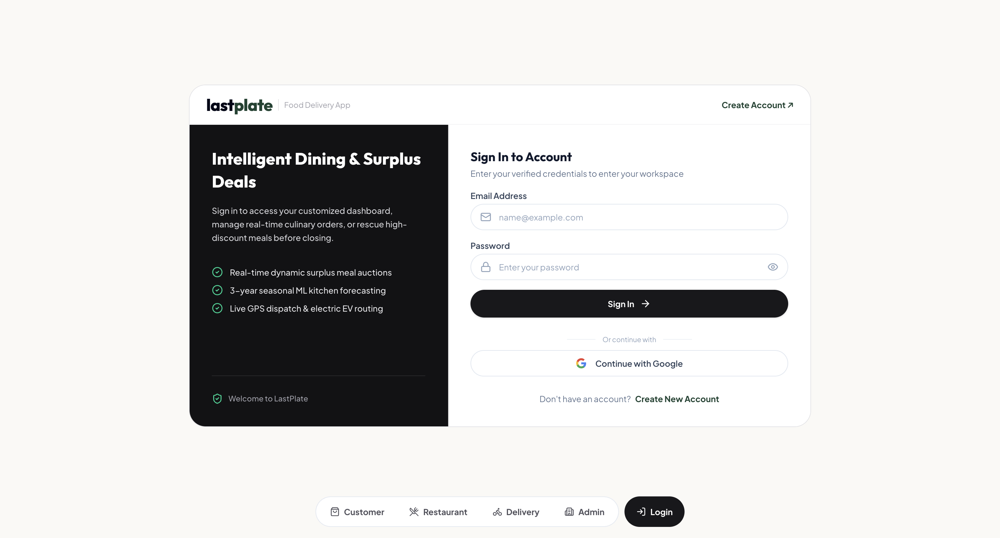
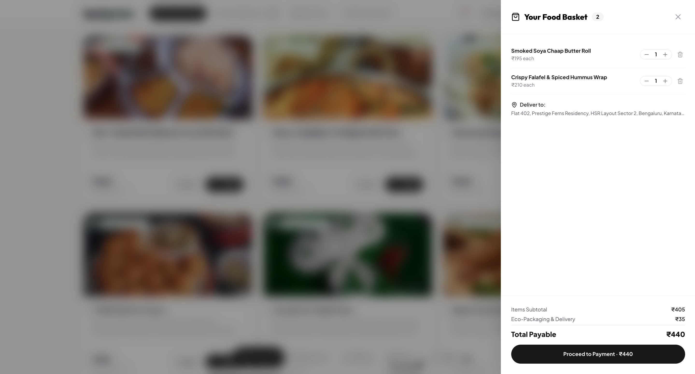
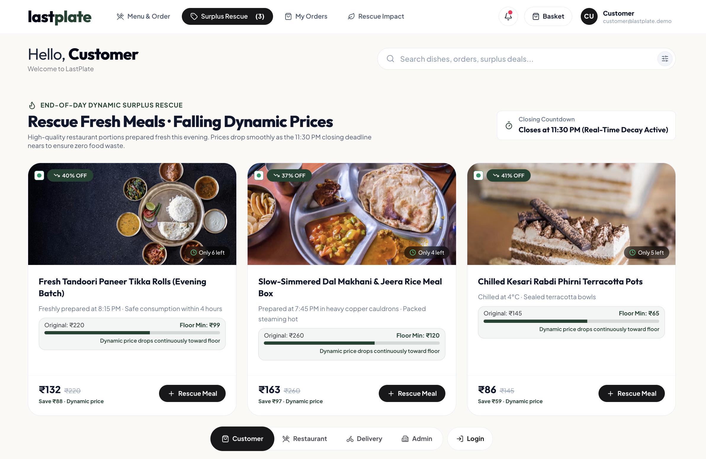
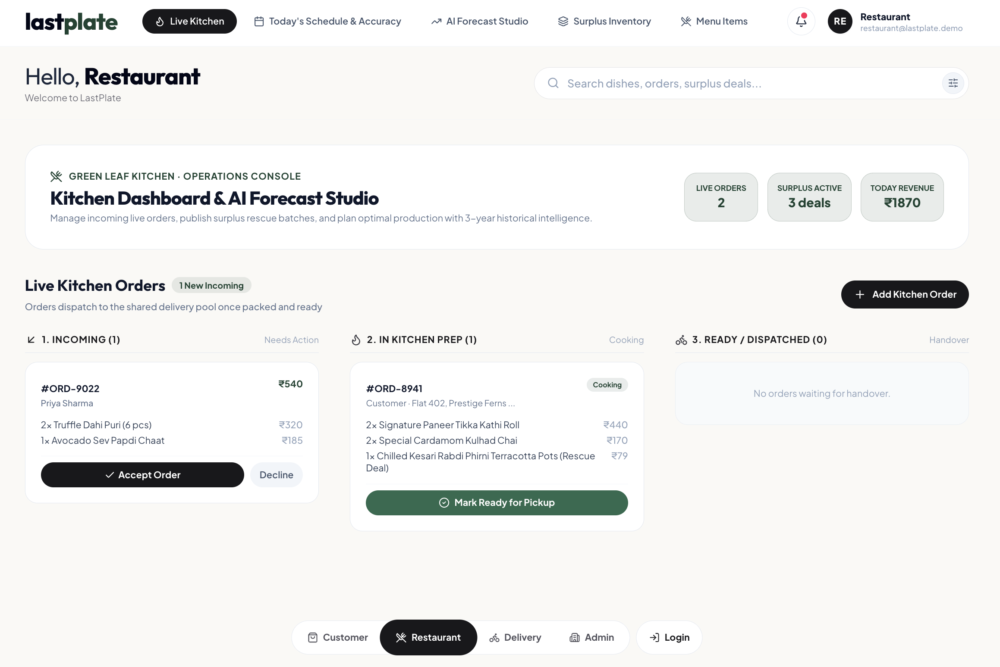
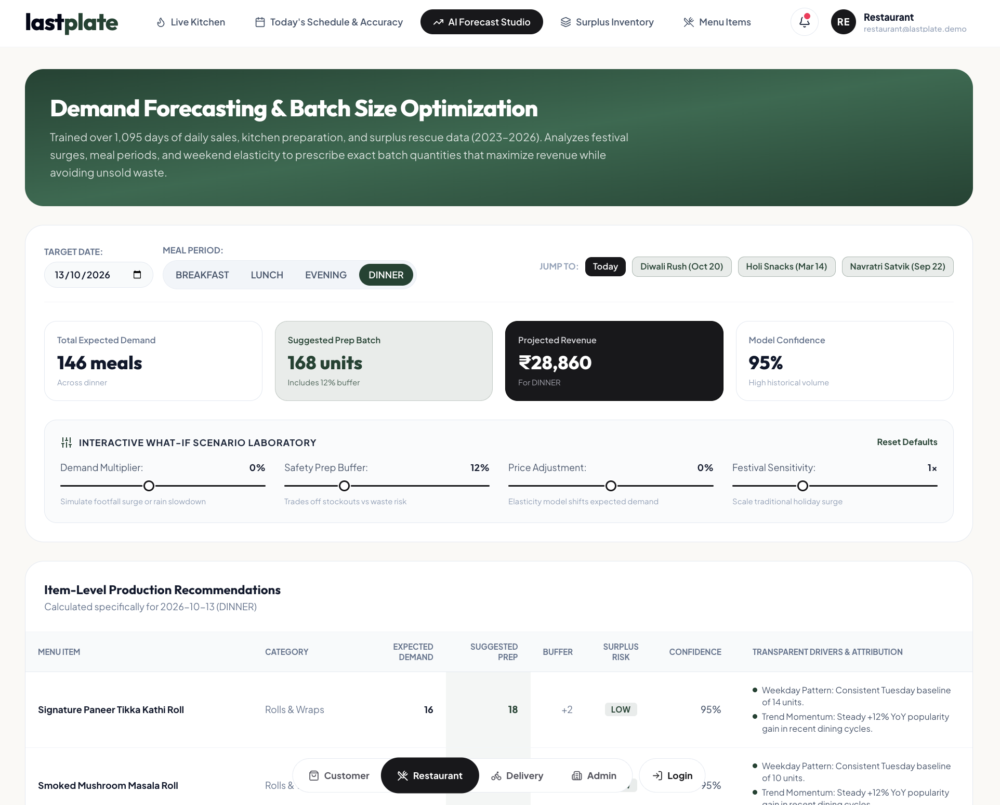

<div align="center">

# LastPlate — Smart Food Delivery & AI Surplus Rescue

**A dual-sided sustainable food delivery platform featuring 3-year historical ML demand forecasting, dynamic closing clearance pricing, live courier tracking, and role-based portals for customers, restaurants, delivery partners, and admins.**

[](https://www.typescriptlang.org/)
[](https://react.dev/)
[](https://tailwindcss.com/)
[](https://nodejs.org/)
[](https://vitejs.dev/)
[](https://firebase.google.com/)

### 🔗 Live: [last-plate-mu.vercel.app](https://last-plate-mu.vercel.app/)

</div>

---

## What it is

Commercial food waste and restaurant operational inefficiencies usually stem from a single structural flaw: kitchens rely on guesswork to decide how much food to prepare each day, and when portions inevitably remain unsold at night, there is no dynamic mechanism to clear them before closing.

I built **LastPlate** to solve both sides of this equation:
1. **Upstream Prevention (AI Studio):** A time-series demand forecasting engine trained across historical operational data of daily kitchen (1,095 days, festivals , seasonal shifts, meal periods) that advises chefs on exact preparation batch sizes with safety buffers to eliminate overproduction.
2. **Downstream Rescue (Dynamic Pricing Engine):** An automated time-decay clearance auction that continuously reduces prices on unsold food as kitchen closing approaches, clearing fresh meals into the hands of budget-conscious diners before expiration.

---

## Visuals

**Customer Portal** — discover fresh chef specials and live surplus rescue deals with dynamic discounts




**AI Studio Demand Forecast** — Historical data time-series forecasting, festival multipliers, and prep optimization




**Dynamic Price Scheduling** — time-decay pricing engine adjusting discounts by closing proximity and portion quantity




**Live Order Tracking & Geolocation** — interactive route simulation, courier status, and customer telemetry


**Delivery Partner Portal** — active delivery pool, dispatch simulator, and shift earnings management




**Admin Governance Portal** — partner verification, FSSAI compliance auditing, and platform metrics




---

## Features

**AI Demand Forecasting & Daily Kitchen Scheduling** — Analyzes historical data (1,095 days) of day-of-week demand patterns, YoY growth, seasonal demand shifts (Monsoon, Winter, Summer), and 24 Indian festival multipliers (Diwali, Eid, Holi, Navratri diet shifts) to output item-by-item prep recommendations with an empirical MAE of 1.64 portions.

**What-If Scenario Simulation** — Kitchen managers can dynamically simulate macro factors like unexpected weather swings (0.5x to 2.0x demand multipliers), safety margin overrides (0% to 25%), and price elasticity ($\epsilon = -1.15$) to preview projected revenue and waste risk before cooking begins.

**Dynamic Price Scheduling (Surplus Clearance Engine)** — Unsold inventory listed in the evening dynamically decays in price as closing time nears. Combines time-to-closing proximity with portion scarcity protection and hard ingredient floor prices so restaurants recover food costs while ensuring complete clearance.

**Four Dedicated Role-Based Portals** —
- **Customer:** Menu browsing, dietary filters (100% Veg toggle), interactive dish nutrient breakdowns, cart checkout with multi-rail payments (UPI, Card, COD), and live courier order tracking.
- **Restaurant Manager / Chef:** Live kitchen order management, POS manual billing, menu catalog CRUD, AI Studio forecasting, and surplus deal publishing.
- **Delivery Partner:** Order pool acceptance, GPS route simulation, delivery status stepper, and earnings ledger.
- **Platform Admin:** Partner onboarding compliance review, FSSAI verification, account approval gating, and system audit logs.

**Authentication & Security** — Google Sign-In via Firebase Auth and standard credentials. Automatic strict onboarding gate: restaurant and delivery partners require admin review before portal access is unlocked.

---

## Stack

| Layer | Tech |
|---|---|
| Frontend | React 19, TypeScript, Tailwind CSS v4, Motion (Framer Motion), Lucide React |
| Backend & Server | Node.js, Express, TypeScript |
| Cloud & Auth | Firebase Authentication (Google OAuth), Cloud Firestore |
| AI / Data Engine | Historical Time-Series Decomposition, Price Elasticity Modeling, Dynamic Markdown Decay |
| Build Tool | Vite 8, esbuild |

---

## Project structure

```text
LastPlate/
├── docs/
│   ├── diagrams/           # StarUML architecture & package diagrams (.mdj)
│   ├── reports/            # Assessment test & design reports (.pdf)
│   └── scripts/            # Report generation utilities
├── public/                 # Static assets, fonts, and web icons
├── screenshots/            # HD screenshots for documentation & README
├── src/
│   ├── components/
│   │   ├── admin/          # Admin governance & partner approval portal
│   │   ├── auth/           # Login, registration, and pending approval views
│   │   ├── calendar/       # Kitchen shift and production calendar
│   │   ├── common/         # Header, drawer, search, and demo account bar
│   │   ├── customer/       # Marketplace, flash deals, cart & order tracking
│   │   ├── delivery/       # Partner dispatch, route simulator & trip logs
│   │   ├── dish/           # Dish details, nutrition facts & recipe cards
│   │   └── restaurant/     # Live kitchen orders, AI Studio & surplus pricing
│   ├── context/            # Global application state & cross-tab sync
│   ├── data/               # Seed data for restaurants, dishes & baseline state
│   ├── services/
│   │   ├── firebase.ts     # Firebase Auth & Firestore client
│   │   └── historicalDataEngine.ts # Historical data ML forecasting & dynamic pricing math
│   ├── types/              # TypeScript definitions & data models
│   ├── App.tsx             # Root router & role-based screen switcher
│   ├── index.css           # Tailwind v4 configuration & base styles
│   └── main.tsx            # React application entrypoint
├── .env.example            # Environment template for Firebase
├── index.html              # HTML shell with Google Fonts
├── metadata.json           # Platform capability metadata
├── package.json            # Dependencies and npm scripts
├── server.js               # Production Express static server
├── tsconfig.json           # TypeScript strict compiler options
├── vercel.json             # Vercel deployment routing rules
└── vite.config.ts          # Vite build & Tailwind plugin config
```

---

## AI Algorithms & Mathematical Formulations

### 1. Historical Time-Series Demand Decomposition
The daily expected portion demand for any dish is computed from historical baseline day-of-week averages compounded by cyclical and calendar regressors:

$$\text{Expected Demand} = \overline{D}_{\text{dow}} \times M_{\text{festival}} \times M_{\text{season}} \times M_{\text{trend}} \times (1 + \epsilon \cdot \Delta P)$$

- **$\overline{D}_{\text{dow}}$**: Day-of-week rolling historical mean over the 1,095-day dataset.
- **$M_{\text{festival}}$**: Multiplier indexed to 24 cultural holidays (e.g., Diwali $+45\%$, Eid $+40\%$, Navratri diet adjustment $-25\%$ on meat/heavy curries).
- **$M_{\text{season}}$**: Meteorological index (e.g., Monsoon cravings $+25\%$ on snacks/chai, Winter $+20\%$ on hearty thalis).
- **$M_{\text{trend}}$**: Annual compounding growth vector ($+5\%$ YoY).
- **$\epsilon$**: Menu price elasticity coefficient calibrated at $-1.15$.

### 2. Batch Prep Sizing & Safety Buffer Optimization
To balance stockout penalties against commercial overproduction waste:

$$\text{Suggested Prep Quantity} = \left\lceil \text{Expected Demand} \times (1 + \text{Buffer}_{\text{safety}}) \right\rceil$$

### 3. Real-Time Dynamic Surplus Markdown Decay
For unsold portions approaching closing time, the dynamic discount rate is computed continuously:

$$\text{Discount Rate}(t, q) = \min\left(1.0, D_{\text{base}} + \Delta D_{\max} \cdot \left(\frac{t - t_{\text{list}}}{t_{\text{close}} - t_{\text{list}}}\right) \cdot U(q)\right)$$

$$\text{Live Price} = \max\left(\text{Floor Price}, P_{\text{original}} \times (1 - \text{Discount Rate})\right)$$

Where $U(q)$ is an inventory urgency scaling factor that accelerates clearance discounts when surplus volume is high, but applies a scarcity buffer to preserve margin when only $1\text{--}2$ portions remain.

---

<div align="center">
<sub>Built by <a href="https://github.com/ahlawatansh">Ansh Ahlawat</a> · CSE undergrad, VIT Vellore</sub>
</div>
